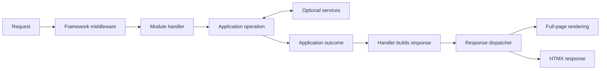

# HyperServer roadmap

## Purpose and status

HyperServer should handle common web infrastructure so developers can focus on features using Go handlers, HTML templates, and HTMX. Provide useful defaults with replaceable services, without requiring developers to assemble security and lifecycle code themselves.

HyperServer is not production-ready. Public interfaces remain experimental during `v0.x`. Resolve known security, correctness, and provider-contract gaps before performance and deployment validation. High performance and low overhead remain goals to prove.

This roadmap defines direction. The [README](readme.md) documents usage, and [architecture decisions](docs/decisions/readme.md) explain specific choices.

## Design principles

- Keep Go's `net/http` model and standard middleware available.
- Keep the core small. Activate optional services only when needed.
- Keep module selection, configuration, and resource ownership visible in application setup.
- Separate responsibilities where replacement or ownership requires it, not into a package or interface for every component.
- Provide safe defaults and report failures accurately. Applications own business rules, access policies, secrets, and deployment choices.
- Support ordinary forms when needed. Applications can depend on HTMX.
- Measure performance before adding complexity or claiming improvements.

### Dependency policy

Prefer the standard library when it does the job. A smaller feature set is acceptable if it keeps HyperServer easier to read and maintain.

Weigh an external package's maintenance, dependencies, and replacement cost against the code it saves. Fewer dependencies reduce supply-chain exposure, but do not justify writing our own cryptography, password hashing, database drivers, or migration engine. Replace only the behavior HyperServer needs, not entire libraries.

## Target user experience

A developer should be able to add a self-registering module and build a persistent feature without changing framework internals. Replacing a service should change its setup, not unrelated handlers.

The example feature must demonstrate validation that preserves non-secret input, replaceable storage, and a fragment update or redirect. Keep an ordinary form-submission example.

## Intended architecture

### Application setup

Keep application decisions in one setup path. Load configuration, select modules and providers, supply shared services, choose middleware and rendering policy, and assign cleanup ownership. Helpers can supply defaults, but selections and overrides must stay visible.

The core coordinates initialization, routing, rendering, serving, and shutdown. It must run without database, authentication, sessions, or mail. Modules own their internal resources, templates, and routes. They must not change other modules' configuration or close application-owned services.

Use typed constructors for application-supplied services and declared capabilities for module-supplied services. Each dependency must have one source. Do not add an unrestricted service locator. Keep diagnostic and sample routes in development modules, outside production applications.

### Responsibility boundaries

| Responsibility | What it does |
| --- | --- |
| HTTP handling | Validates input, enforces request limits and access rules, calls the operation, and writes the response. |
| Application operations | Apply business rules and decide which changes must succeed together, without choosing HTTP responses or session messages. |
| Persistence | Stores and retrieves data with the required uniqueness, concurrency, expiration, and durability guarantees. |
| Serialization | Encodes and decodes stored values using the consuming service's format and compatibility rules. |
| Rendering | Produces escaped HTML. Response dispatch chooses pages or fragments and applies redirects, notifications, and HTMX instructions. |

A rendering or notification failure must not be reported as a failed account change after storage commits. Templates must not change storage or sessions.

### Self-registering modules

Package `init()` functions register immutable metadata and factories, without opening resources or activating routes. The process-wide catalog lists available modules. Each application selects modules and owns separate instances. Tests can supply local catalogs.

Before accepting traffic, resolve dependencies, initialize providers before consumers, and reject missing requirements, ambiguous providers, cycles, and route conflicts. Define behavior for missing optional services. A broken provider must not silently disable required behavior.

Use explicit, configurable startup and shutdown deadlines. A failing initializer releases its partial resources. Close initialized modules in reverse dependency order on startup failure. During shutdown, drain requests before closing services. Every resource must have one owner.

### Storage and serialization

Define narrow repositories near their consumers. Keep queries and backend-specific errors in providers. Modules can also use native clients or build repositories around shared connections. Do not add a universal database or query API.

One application can use several storage platforms. Each provider must satisfy its consumer's guarantees. SQLite, PostgreSQL, MongoDB, files, and cloud storage are not interchangeable just because they store data.

Application operations decide which writes must be atomic. Providers enforce those transactions. Consuming a recovery token and changing the account, for example, must succeed together. Do not promise atomicity across unrelated platforms. Add cross-repository transaction binding only when a concrete workflow needs it.

Prepare module storage before activation. Modules must not close shared connections they do not own. Services must allow serializer replacement independently of storage.

Providers own schema migrations and independent version histories, including separate histories for configured session tables. Deployment controls upgrades using established tooling. Fresh setup and migrations must share schema definitions. Startup must reject unsupported existing storage without silently repairing it. See the [storage guide](docs/storage.md) for current procedures.

Version payloads separately from schemas, with unambiguous format markers. Reject unknown versions and define conversion or backward compatibility for changes. Applications can invalidate sessions instead of converting them, but must preserve durable records. Custom serializers own their compatibility rules. File contact storage remains a sample.

### Caching and rendering

The code using a cache chooses what to store, how long to keep it, when to remove it, and what to do if caching fails. The cache enforces expiration and size limits and handles concurrent access. The original data remains the source of truth.

Keep parsed-template reuse separate from general caching. HTTP caches must distinguish pages, fragments, and personalized responses without exposing one user's or tenant's data to another.

## Remaining priorities

Work in this order, with security defects taking precedence throughout.

### 1. Establish performance baselines and add justified caching

- Benchmark rendering, middleware, sessions, and representative requests. Record workload, environment, latency, allocations, and memory. Profile before optimizing.
- Add a bounded in-memory cache and no-op implementation only for demonstrated consumers. Define isolation, freshness, invalidation, concurrent misses, and failure behavior.
- Test cached reads after mutations and failures, including the deployment's HTTP cache behavior.
- Measure cache hits, misses, evictions, and errors. Set performance, memory, and build-size budgets from stable baselines and add regression checks.

### 2. Validate deployment and recovery

- Add liveness and readiness checks. Readiness must reflect the services needed to serve traffic.
- Log response status, duration, lifecycle failures, and security events with request correlation and secret redaction. Keep metrics and tracing optional.
- Add vulnerability scanning, reviewed dependency updates, and repeatable builds with version and commit metadata.
- Test a container or service deployment from a clean environment. Document secrets, TLS/proxies, resource limits and locations, and migration ownership.
- Test backups and restores of accounts, sessions, and application records, plus migration rollback or forward repair.
- Run load, restart, failure, and soak tests. Cover request limits, recovery timing, slow mail, storage outages, startup failure, and shutdown during active requests. Minimum response times cannot conceal longer work.
- Obtain an independent security review before exposing account and recovery flows publicly. Maintain HTTP and browser regression coverage.

Add optional automatic session and token cleanup with bounded batches and no overlapping runs. Report failures and stop cleanup before storage closes. External scheduling remains sufficient for deployment readiness.

Validate the configuration being deployed. Unused adapters and caches must not block it.

### 3. Prove framework replacement and reuse

- Run shared contract tests and a representative workflow against PostgreSQL and one suitable file, document, or cloud adapter, without changing handlers or operations. Document backend requirements and data migration.
- Build an application outside this repository using documented setup and self-registering modules. Demonstrate a persistent feature with full-page and HTMX success and failure paths, without copying reference-application infrastructure.
- Use that application to test provider and serializer replacement, isolation, and cleanup ownership. Fix demonstrated coupling without adding speculative abstractions.
- Document extension contracts and runnable examples. Stabilize interfaces only after real usage, with explicit compatibility and deprecation policies.
- Choose a license and publish a security-reporting policy before inviting adoption. The maintainer must choose the license.

## Scope limits and deferred decisions

Add adapters when applications need them. Defer broad ORM features, a universal query language, distributed caches, a job system, and a scaffolding generator until real requirements justify them.

Runtime plugins need a separate design for activation, compatibility, request draining, and replacement. Import-based discovery alone does not provide safe runtime loading.

If delivery must survive restarts, add an optional durable service with an atomic outbox and safe retries. Do not promise exactly-once email delivery.

Evaluate opaque recovery tokens and session identifiers separately from urgent security fixes. Keep established signing and password-hashing implementations unless a validated design removes the need for them.
