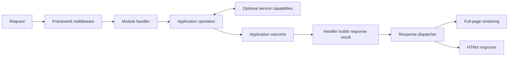

# HyperServer roadmap

## Purpose and status

HyperServer is an experimental Go framework for server-rendered web applications with first-class HTMX support. It should handle the recurring infrastructure so developers can focus on application features using familiar Go handlers and HTML templates.

Provide a working default setup with replaceable services. Developers must not need to learn unrelated libraries or copy security and lifecycle code to build a feature. High performance and low overhead are goals to demonstrate with measurements.

HyperServer is not production-ready. Public interfaces remain experimental during `v0.x`. The immediate work is shared storage-provider tests and stored-format migrations, followed by performance and operational validation.

This roadmap defines direction and remaining priorities. The [README](readme.md) documents usage. [Architecture decisions](docs/decisions/readme.md) explain specific choices and their tradeoffs.

## Design principles

- Keep Go's `net/http` model and standard middleware available.
- Keep the core small. Authentication, sessions, persistence, caching, and mail are replaceable services, activated only when needed.
- Preserve import-based module discovery, with explicit application-owned configuration and activation.
- Keep configuration and resource ownership easy to trace from application setup.
- Separate responsibilities where replacement or ownership requires it. Do not create a package or interface for every component.
- Provide safe defaults and report failures accurately. Applications still own business rules, access policies, secrets, and deployment choices.
- Support ordinary navigation and form submissions when an application requires them. Applications can depend on HTMX.
- Measure performance before adding complexity or claiming improvements.

### Dependency policy

Prefer the standard library when it does the job. A smaller feature set is acceptable if it keeps HyperServer easier to read and maintain.

An external package must justify its maintenance, transitive dependencies, and replacement cost alongside the code it saves. Fewer dependencies reduce supply-chain exposure, but dependency removal is not a reason to write our own cryptography, password hashing, database drivers, or migration engine.

Replace only the behavior HyperServer needs, not entire libraries. Keep established security components and inspect the dependency graph after replacements.

## Target user experience

A developer should be able to configure an application, add a self-registering module, and implement a persistent feature without changing framework internals. Replacing a service should change its selection and wiring, not unrelated modules or handlers.

A representative interaction follows this flow:

The representative feature must demonstrate validation with preserved non-secret input, persistence through a replaceable repository, and a successful fragment update or redirect. Keep an ordinary form-submission example to demonstrate progressive enhancement.

## Intended architecture

### Application setup

Keep application decisions in one setup path, in one file or a small group of related files. Load configuration once. Select modules and providers, supply shared services, choose middleware order and shared rendering policy, and assign resource ownership.

The core coordinates module initialization, route validation, rendering, HTTP serving, and shutdown. It must run without database, authentication, sessions, or mail. Modules own their internal resources, templates, and routes. They must not change another module's configuration or close borrowed resources.

Supply application-owned services through typed constructors or options. Dependencies supplied by other modules use declared capabilities. Each dependency must have one source. Do not introduce an unrestricted service locator.

Shared helpers can assemble cohesive defaults, but their selection and overrides must remain visible in setup. Keep the stateless example small and independent of optional services. Keep diagnostic and sample routes in development modules, outside production applications.

### Responsibility boundaries

These boundaries define architectural ownership.

| Responsibility | What it does |
| --- | --- |
| HTTP handling | Reads and validates request input, enforces request limits and access policy, calls the operation, and writes the response. |
| Application operations | Apply business rules and decide which changes must succeed together. Return results without choosing HTTP responses or session messages. |
| Persistence | Performs storage operations and provides the required uniqueness, concurrency, expiration, and durability guarantees. |
| Serialization | Encodes and decodes stored values. The consuming service chooses the format and compatibility requirements. |
| Rendering | Produces escaped HTML from prepared templates and data. Response dispatch selects full pages or fragments and applies redirects, notifications, and HTMX instructions. |

A rendering or notification failure must not be mistaken for a failed account change after the storage operation commits. Templates must not perform storage or session mutations.

### Self-registering modules

Package `init()` functions register immutable metadata and factories only. The process-wide module catalog describes available modules. Each application selects its modules and owns separate runtime instances. Tests can supply local catalogs. Registration must not acquire resources or activate routes.

Initialization must resolve declared dependencies, reject missing required capabilities, ambiguous provider selections, and cycles, initialize providers before consumers, and reject route conflicts before accepting traffic. Missing optional capabilities need defined behavior. Provider failures must not silently disable required behavior.

Initialization and shutdown must use explicit, configurable deadlines. A failing initializer releases its partial acquisitions. On startup failure, close completed modules in reverse dependency order. During shutdown, drain requests before closing consumers and their providers. Every resource has one owner.

### Storage and serialization

Define narrow repositories near their consumers. Keep backend queries and backend-specific errors in providers. Applications and modules can use backend clients directly or build repositories around shared connections. Do not introduce a universal database or query API.

An application can use several storage platforms. Each provider must satisfy its consumer's guarantees. SQLite, PostgreSQL, MongoDB, files, and cloud storage are not interchangeable simply because they can store data.

The application operation decides the transaction boundary. Providers must bind participating repository operations to the same transaction. For example, consuming a recovery token and changing the account must succeed together. Do not imply atomicity across unrelated storage platforms.

Add cross-repository transaction binding only when a concrete application workflow needs it. Keep existing atomic account operations self-contained.

Modules own their storage objects and prepare them before activation. A module borrowing a connection does not own that connection. Services storing encoded values must allow serializer replacement without replacing storage.

### Caching and rendering

The code using a cache decides what to store, how long it can remain valid, when to refresh or remove it, and how to recover from cache failures. The cache implementation enforces expiration and size limits and handles concurrent access. The original data remains the source of truth.

Keep parsed-template reuse independent of a general cache service. HTTP and fragment caches must distinguish full pages, fragments, and personalized responses. User or tenant data must not cross cache boundaries.

## Remaining priorities

Work through these priorities in order, using the reference application to validate changes. Security defects take precedence throughout.

### 1. Complete storage and serialization contracts

- Add an in-memory contact test adapter and run shared create-contract tests against it and SQLite. Cover generated fields, repeated submissions, cancellation, concurrent writes, and failed writes. Explicitly configure connection limits, foreign-key enforcement, and lock waits for application, session, and maintenance pools.
- Define stored-format versions and migration procedures. Reject incompatible schemas during provider startup. Test invalid data, interrupted migrations, and rollback or forward repair.

Outcome: service contracts describe the behavior a replacement must preserve, and tests establish that behavior independently of the selected implementation.

### 2. Establish performance baselines and add justified caching

- Benchmark rendering, middleware, sessions, and representative requests. Record workload, environment, latency, allocations, and memory use. Profile before selecting optimizations.
- For demonstrated consumers, add an optional bounded in-memory cache and a no-op implementation. Define key isolation, freshness, invalidation, concurrent misses, and failure behavior for each integration.
- Test cached reads after mutations and failures. Verify page, fragment, and personalized-response policies against the deployment's actual HTTP caches.
- Measure hits, misses, evictions, and errors. Set latency, allocation, memory, and build-size budgets from stable baselines and add repeatable regression checks.

Outcome: performance claims are reproducible, resources remain bounded, and cache behavior has explicit correctness tests. If no consumer needs a cache, defer its implementation rather than inventing one.

### 3. Validate deployment and recovery

- Add liveness and readiness checks. Readiness must reflect the enabled capabilities needed to serve traffic.
- Extend request and lifecycle logging with response status, duration, failures, and security audit events. Preserve correlation and redact secrets. Keep metrics and tracing integrations optional.
- Add dependency vulnerability scanning, reviewed update proposals, and repeatable builds with version and commit metadata.
- Provide a container or service deployment with documented secrets, TLS/proxy settings, resource limits, migration ownership, and configured resource locations. Use established migration tooling and test deployment from a clean environment.
- Back up and restore deployed data stores. Verify restored accounts, sessions, and application records, and exercise migration rollback or forward repair.
- Run load, restart, dependency-failure, and soak tests. Include request and rate limits, recovery-response timing, slow mail, storage outages, failed startup, and shutdown with active requests. A minimum response time does not conceal work that takes longer than that minimum.
- Run an independent security review before exposing account and recovery flows to public traffic. Preserve HTTP and browser regression coverage as features and assets change.

Add optional automatic, bounded session and token cleanup. Prevent overlapping runs, report failures, and stop cleanup before storage closes. External scheduling remains sufficient for deployment readiness.

Outcome: a clean environment can deploy, operate, recover, and restore the application from documented procedures. Readiness applies to the configuration tested. Unused adapters and caches do not block a deployment.

### 4. Prove framework replacement and reuse

- Run the same contract tests and representative workflow against PostgreSQL and one suitable filesystem, document, or cloud-storage adapter. Keep handlers and application operations unchanged. Document backend requirements and data migration.
- Build an application outside this repository using documented setup, self-registering modules, supplied services, and security defaults. Implement a persistent feature with full-page and HTMX success and failure paths without copying reference-application infrastructure.
- Use that application to validate provider and serializer replacement, isolation, and cleanup ownership. Remove coupling revealed by real usage without adding speculative abstractions.
- Document module and service extension contracts. Stabilize interfaces only when usage supports them, with explicit compatibility and deprecation policies.
- Choose a project license and publish a security-reporting policy before inviting outside adoption. The maintainer must choose the license.

Outcome: developers can build an application and replace its services through documented setup. Start with runnable examples and concise instructions, not a scaffolding generator.

## Scope limits and deferred decisions

Add adapters when applications need them. Defer broad ORM features, a universal query language, distributed caches, and a general job system until demonstrated requirements justify them.

Runtime plugin loading needs a separate design for activation, compatibility, request draining, and replacement. Preserve module registration and ownership boundaries without treating discovery as permission to load or replace code during requests.

If delivery must survive a restart, add an optional durable delivery service with an atomic outbox and safe retries. Do not promise exactly-once email delivery.

Evaluate opaque recovery tokens and session identifiers separately from security fixes. Keep established signing and password-hashing implementations unless a validated replacement design removes the need for them.
