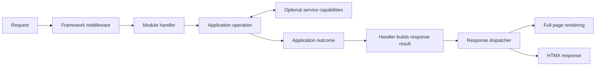

# HyperServer roadmap

## Purpose and status

HyperServer is an experimental Go framework for server-rendered web applications with first-class HTMX support. Its purpose is to handle recurring web application infrastructure so developers can focus on application features using familiar Go handlers and HTML templates.

Provide a working default setup with replaceable components, without requiring every application to assemble its infrastructure from scratch. Keep code straightforward to read and maintain. High performance and low overhead are design goals that require measurement.

This document defines the intended architecture and implementation order. Planned capabilities are requirements, not claims about the current implementation. Treat the API as experimental and use `v0.x` releases while its contracts evolve.

### Current implementation

Phase 0 is complete. Phase 1 is in progress. HyperServer is not ready for public deployment.

[CI](.github/workflows/ci.yml) runs tests, vet, and full-suite race checks. These checks do not establish production readiness or replace a security audit. Performance has not been measured.

| Area | Current state | Remaining work |
| --- | --- | --- |
| Startup and modules | [Server construction](pkg/server/server.go) creates only routing and rendering services. Applications initialize optional services explicitly. [Handler](pkg/handlers/handlers.go) and [auth](auth/auth_service.go) catalogs hold factories, with fresh instances per application and local catalogs for tests. [Module initialization](pkg/handlers/initialize.go) resolves dependencies and rolls back completed modules on failure. Bundled assets are embedded, rendering accepts explicit filesystems, and local storage paths resolve without changing the process directory. A [stateless greeting application](examples/stateless/readme.md) exercises these contracts without optional services. Both applications use shared module setup and HTTP lifecycle helpers. | Extend provider replacement coverage in Phase 4. |
| Shutdown and TLS | The [reference application](cmd/web/main.go) supports direct TLS and an explicitly trusted edge proxy. Verified client IPs and HTTPS state feed rate limits and session cookies. Links use configured addresses. Shutdown drains requests before closing modules in reverse dependency order, then shared services. Drain timeouts force process exit without closing services under active handlers. | Exercise restart and shutdown under load. |
| Configuration and middleware | Applications own [configuration copies](config/clone.go), database pools, and session providers. [Two-server tests](cmd/web/module_isolation_test.go) cover separate data and sessions, disabled authentication, and shutdown isolation. [Session middleware](pkg/services/session/middleware.go) can attach sessions without account storage. [General middleware](pkg/services/middleware/middleware.go) has no account or session storage dependency. Its [route-level authorization](pkg/services/middleware/authorization.go) evaluates application-defined policies. [Authentication middleware](auth/middleware/auth.go) supplies identity-based guards. The stateless application also runs beside the reference site's module in tests. | Extend isolation coverage as replacement providers are added. |
| Forms and account writes | [Route registration](pkg/routing/routes.go) applies body limits and inherited per-route rate policies. Handler policies override module and application defaults. Explicit [shared budgets](pkg/ratelimit/limiter.go) apply independently, including an optional application budget before session loading. The [HTTP stack](cmd/web/main.go) uses Go's CSRF protection. The [form parser](pkg/components/form/request.go) checks field sizes before binding. [Account creation and updates](pkg/services/user/sqlite/account_repository.go) use separate operations. Updates reject outdated security versions. | Prevent credential exposure when HTMX is unavailable or forms redisplay. Validate limits under load. |
| Recovery and verification | [Password reset](pkg/services/user/auth_token_reset.go) and [account verification](pkg/services/user/auth_token_verification.go) use emailed, single-use links. Token consumption and the account change share a transaction. Verification links are bound to the recipient's email address. Admitted reset requests have a minimum response time. Rate limits do not depend on account existence. | Test timing under load. |
| Mail and sessions | [SMTP delivery](pkg/services/messaging/mail.go) has timeouts and cancellation. Authentication uses revocable [SQLite sessions](pkg/services/session/sqlitestore.go), with ID rotation at login and verification. Password reset or change invalidates all account sessions. Each session manager owns its selected providers and closes their pools after requests drain. [Session JSON](pkg/services/session/readme.md) is limited to 64 KiB and cookies to 4 KiB. An explicit [cleanup command](cmd/cleanup) removes expired sessions and account tokens in bounded batches. | Add optional automatic cleanup with application lifecycle management. |
| Exposure and redirects | The [reference application](cmd/web/main.go) is loopback-only. [Authentication mutations](auth/auth_manager.go) and [site mutations](modules/site/router.go) require POST. Verification and reset links display forms without consuming tokens. [Redirects](pkg/util/redirect.go) accept local paths and use HTTP 303 or HTMX headers without rendering HTML or JavaScript. | Keep development modules out of production applications. |
| Browser security | The [reference CSP](cmd/web/security.go) blocks inline scripts and evaluation. HTMX uses external scripts and styles, without fragment scripts or local history snapshots. [Security headers](pkg/services/middleware/security.go) cover pages, fragments, and errors. HSTS is opt-in for verified HTTPS. Cookie attributes have HTTP and provider-level tests. | Keep the CSP aligned with application assets and features. |
| Rendering and tests | Form and site messages are escaped as text. [Page and fragment rendering](pkg/components/content/content.go) completes before sending content headers, status, and body. Rendered responses vary on `HX-Request` and default to `no-store`, with explicit cache policies for suitable content. Message values have no storage dependency. Rendering accepts an optional notification loader. Session-backed [flash messages](pkg/services/flash/messages.go) persist category removal and report storage failures. [HandleError](modules/site/error.go) keeps internal details in logs. Failed error-page rendering returns a plain-text 500. Templates are parsed per response. The [HTTP harness](cmd/web/http_test.go) uses isolated databases, explicit configuration, and fake mail. | Reuse parsed templates. |

## Design principles

- **Go's foundations.** Keep `http.Handler`, `http.Request`, `http.ResponseWriter`, `context.Context`, and standard middleware interoperable.
- **Standard library first.** Prefer Go's standard library when it meets requirements with clear, maintainable code. Accept narrower functionality when it improves readability, auditability, operation, and replacement.
- **Small core, composable services.** Keep rendering and HTMX response handling in the core. Activate authentication, sessions, persistence, caching, and mail through replaceable contracts when required.
- **Self-registering modules.** Imports register metadata. Each application owns dependency resolution, initialization, routes, and shutdown.
- **Progressive enhancement as a capability.** Support ordinary navigation and form submissions when an application requires them. Applications can depend on HTMX.
- **Explicit ownership.** Define framework and provider responsibilities without prescribing application structure or domain models.
- **Safe defaults and honest outcomes.** Validate required capabilities, surface failures, and make secure behavior the default.
- **Measured performance.** Require repeatable benchmarks or profiles before claiming an improvement.

Defer broad ORM features, a universal query language, speculative adapters, distributed caches, and a general job system until real requirements justify them.

### Dependency policy

Prefer the standard library when it does the job. A smaller feature set is acceptable if it keeps HyperServer easier to read and maintain.

An external package needs to earn its place. Check who maintains it, what dependencies it brings, and how much work replacing it would take. Those costs matter alongside the code it saves us.

Keeping dependencies down also limits exposure to supply-chain attacks. That preference does not justify writing our own cryptography or password hashing. Use established, maintained implementations for that work.

Logging uses `log/slog` behind the [logging contract](pkg/services/logger/logger.go). [Configuration loading](config/load.go) applies explicit defaults, YAML settings, and environment overrides before validation. Continue reducing dependencies in this order. Replace the behavior HyperServer needs, not the full libraries.

| Dependency | Planned change |
| --- | --- |
| `go-playground/validator` | Use explicit form validation and field errors. Define email acceptance and test existing rules. Do not build another tag-driven validation engine. |
| `jmoiron/sqlx` | Evaluate `database/sql` during repository extraction. Prefer explicit queries and scanning where the added repetition is manageable. |

Keep `golang.org/x/crypto/bcrypt` and a maintained SQLite driver. Use established tooling such as `golang-migrate` for versioned migrations, which can run separately during deployment. Keep `google/uuid` unless opaque identifiers meet the application's needs and the storage and compatibility costs justify changing formats.

JWT signing and validation use `golang-jwt/jwt/v5`. Separately evaluate whether server-side sessions and opaque recovery tokens remove the need for JWTs. Do not write a JWT implementation.

After each replacement, inspect the dependency graph to confirm what disappeared. An optional provider can still add module dependencies. Reduce maintenance and complexity, not just the number of entries in `go.mod`.

## Target user experience

Developers must be able to select the services they need and use a documented setup that supplies common security controls, request handling, and lifecycle management. Building a feature must not require learning unrelated provider APIs or copying framework setup code. Applications still own their business rules, access policies, secrets, and deployment settings.

A representative interaction follows this flow:

Application operations return outcomes independently of HTTP presentation. Handlers map those outcomes to response results. The dispatcher handles request classification, view selection, redirects, notifications, and HTMX response metadata.

The reference feature must demonstrate a form submission, validation errors that preserve non-secret input, persistence through a replaceable repository, and a successful fragment update or redirect. It must also demonstrate an ordinary form submission as an example of progressive enhancement.

## Intended architecture

### Core and service capabilities

The core provides server lifecycle, module composition, routing, middleware, configuration validation, rendering, response dispatch, error handling, and observability hooks. It must run without database, authentication, session, or mail services.

Providers supply sessions, authentication, caching, repositories, storage, and mail. Applications define authorization policy, which framework hooks enforce where required.

Form binding and input validation are transport helpers. Business validation belongs to application rules. Notifications are response or session data with rendering support.

The code using a cache decides what to cache, how long it can remain valid, and when to refresh or remove it. The cache implementation stores those copies, enforces expiration and size limits, and handles concurrent access. Callers decide how to recover from cache failures. The original data remains the source of truth.

The included site module exercises framework features in the local development application. It owns its diagnostic and sample routes. Production applications must not load development modules. Route inclusion follows module selection, not an application-wide development flag.

### Application setup

Keep application decisions in one setup path, in one file or a small group of related files. The following describes the target boundary. Optional services still live on `ApplicationServer`, and the site module currently installs shared rendering policy during initialization.

The web and cleanup commands already load configuration once and pass it to consumers. Keep configuration file and environment access there, with provider validation operating on supplied settings. [Configuration and provider defaults](readme.md#configuration) describe current selection and replacement behavior.

Account-provider selection and opening belong to [reference application setup](internal/reference/accounts.go), which uses configuration without depending on a server instance. Web startup supplies the repository and registers shutdown cleanup. The cleanup command opens and closes maintenance storage independently. The core does not import the account-storage implementation. Removing the repository field and remaining optional-service construction from the core remains separate work.

| Owner | Responsibility |
| --- | --- |
| Application setup | Loads configuration once, selects modules and providers, supplies shared services, chooses middleware order and shared rendering policy, and assigns resource ownership. |
| Core | Coordinates module initialization, route checks, rendering, HTTP serving, rollback, and shutdown. It must not select or construct optional service implementations. |
| Module | Validates its supplied dependencies, prepares its internal resources and templates, and binds its routes. It must not change another module's configuration or close borrowed resources. |
| Service provider | Implements its contract and prepares its own resources from supplied settings. It must not independently load application configuration. |

Keep `ApplicationServer` as the core runtime passed to module initialization, not a catalog of every service an application might use. Application setup can hold related services in a typed struct and supply them through module options or constructors. Dependencies supplied by other modules use the existing declared-capability resolver. Each dependency must have one source. Do not add a service locator or another registration framework.

Imports make modules discoverable. Setup must select modules or deliberately select the registered catalog. Registration alone must not activate routes or acquire resources.

#### Reference application

Keep the setup entry in [cmd/web/main.go](cmd/web/main.go), with module selection in [site_modules.go](cmd/web/site_modules.go) and route defaults in [handlers.go](cmd/web/handlers.go):

1. Load settings and command-line options once. Resolve resource paths and validate selections before opening services.
2. Prepare the services required by the site and configured authentication features. The default setup uses SQLite accounts and sessions, SQLite or file-based contacts, and the configured mail sender. Supply these services to their consumers outside the core container.
3. Explicitly select the site's shared rendering defaults, including layouts, navigation data, notification loading, error handlers, and redirect URLs. Apply application overrides before serving. Modules still own their page templates and routes. Competing owners of a single setting must produce an error, not depend on module order.
4. Initialize the selected modules with `handlers.Setup`. Assemble the HTTP stack in `applicationHandler`: request logging, security headers, proxy verification, HSTS, optional shared rate limits, origin checks, session or identity loading, and route dispatch. Supply the listener and HTTP server to `app.Run`.

An optional-service helper can assemble a cohesive default setup. Its call and overrides must be visible here. Replacing account storage must change provider selection and wiring, not the renderer, core lifecycle, or unrelated modules.

#### Stateless application

Keep settings and HTTP setup in [examples/stateless/main.go](examples/stateless/main.go) and module assembly in [app.go](examples/stateless/app.go):

1. Read the application name, loopback port, and shutdown timeout from flags. No configuration file or optional service setup is required.
2. Create the core runtime and select only `pages.Module()`. The greeting module owns its templates. No notification loader, account service, session manager, storage provider, or mail client is supplied.
3. Use `handlers.Setup` for modules and routes. Wrap the router with security headers, configure HTTP timeouts, and use `app.Run` for serving and cleanup.

#### Resource ownership and scope

Register cleanup for each successfully returned resource before its consumers initialize. A helper that fails before handing over ownership must release its partial acquisitions. Register each resource with one owner, not both the helper and its caller. `handlers.Setup` registers module cleanup after shared services, so reverse-order shutdown closes modules first. Modules can own repositories while borrowing application-owned connections. Retain startup rollback, request draining, and the rule against closing services under active requests after a drain timeout.

Keep related types and defaults together. Split a package only to remove an unwanted dependency or establish a useful replacement or ownership boundary. Do not require an interface, package, configuration file, or Go module for every component.

### Responsibility boundaries

Each part of HyperServer has a specific job when handling a request:

| Boundary | What it does |
| --- | --- |
| Transport | Reads the HTTP request, enforces request limits, and calls the matching handler. Writes the status, headers, cookies, and HTMX instructions. Keeps internal error details out of public responses. |
| Application integration | Lets a handler call application code, such as account registration, with the input it needs. The handler turns the returned value or error into a response. HyperServer does not require application code to know how that response is sent. |
| Persistence integration | Gives services access to operations such as finding a user or saving a session. The selected storage implementation performs the queries or file operations and handles concurrent writes. |
| Serialization | Encodes values into a format such as JSON and decodes them when read. The code using the serializer chooses the format and defines how older saved data stays readable. |
| Rendering | Runs the selected page or fragment template with its data and escapes values for HTML output. Returns the HTML body for transport to send. |

The application decides which changes must succeed together. For example, changing a password and consuming its reset token must form one transaction. The storage implementation commits both changes or rolls both back.

A handler's response result connects these parts. It identifies the view and data to render, along with response details such as a redirect or HTMX event.

### Self-registering modules

Modules register immutable descriptors through package `init()` functions. Registration performs no configuration loading, I/O, route binding, migration, or background work.

Each module owns its internal setup, requirement checks, and route binding. Applications select and configure modules and supply shared services. Modules must not initialize or close borrowed services.

The process-wide **module catalog** describes available module types, factories, and required, optional, and provided capabilities. Each server snapshots the catalog into a **per-application registry** that owns enabled module instances and their runtime state. Tests can supply local catalogs.

Startup must:

1. Validate module names and select enabled modules.
2. Resolve required capabilities and explicitly select among competing providers.
3. Reject unresolved requirements, ambiguous selections, and dependency cycles.
4. Initialize modules in dependency order using typed dependencies or a resolver limited to declared capabilities.
5. Validate duplicate or conflicting route patterns and finish route registration before accepting traffic.

Multiple providers can advertise the same capability. Configuration selects a provider unless the consumer explicitly accepts several. A missing optional capability must have defined behavior.

On startup failure, close completed modules in reverse order. A failing initializer must release partially acquired resources. Module factories perform no I/O. Normal shutdown drains HTTP requests before closing dependent services in reverse order.

Descriptors contain a name, factory, and capability requirements and provisions. [Module initialization](pkg/handlers/initialize.go) resolves provider selections, initializes providers, and passes each consumer only its declared dependencies. Consumers read services through their own interfaces. Missing optional services return a zero value or empty slice. Failed or incompatible providers stop startup. Route binding reports pattern conflicts through `Routes.Err()` after initialization and before traffic. Application-supplied services still need explicit wiring.

Modules can implement `Shutdown(context.Context) error` for owned resources. [Module cleanup](pkg/handlers/shutdown.go) closes consumers before providers and joins errors. The application registers successful modules for shutdown and closes shared services afterward. Cleanup uses a ten-second default or the caller's deadline. Hooks must honor cancellation. Context-free storage close functions cannot be interrupted.

Storage setup runs during initialization, before consumers and routes become active. Module initialization uses the caller's deadline or a ten-second default for the whole phase. The reference application supplies that deadline through `app.initializationTimeout`. Providers must honor the context and leave borrowed pools open for their owner to close. Tests cover storage failures, deadlines, dependency ordering, and repositories sharing a pool.

### Rendering and HTMX responses

A handler response result can describe full-page or fragment rendering, validation errors, redirects, notifications, out-of-band updates, client events, retargeting, and reswapping. Keep direct `http.Handler` use available for downloads, streaming, and specialized responses.

The response dispatcher owns HTTP and HTMX decisions. The renderer produces HTML. HTMX response headers are not processed on 3xx responses, so redirect handling must select the appropriate response behavior. [HTMX response documentation](https://htmx.org/docs/#response-headers)

Parse reusable template sets at startup or controlled development reload. Use `html/template` with trusted templates and escaped data. Restrict `template.HTML` to reviewed trust boundaries. [Go template documentation](https://pkg.go.dev/html/template)

## Storage and serialization

Replacement contracts must describe behavior consumers need. SQLite, PostgreSQL, MongoDB, local files, and cloud storage are candidate providers, not interchangeable guarantees.

### Data access contracts

Use narrow repositories for operations such as finding a user or creating an account. Framework services can use smaller key/value or blob contracts when those match their needs. Do not introduce a universal database or query API.

Authentication uses [AccountRepository](pkg/services/user/account_repository.go) for account and token operations. The reference application's `auth.accountStorage` selects a provider registered with its setup. SQLite borrows the shared pool. Web startup registers cleanup for owned resources before consumers initialize. Other applications supply their chosen repository directly. Automatic module discovery and dependency resolution remain separate startup work.

[Session-backed identity](auth/identity/session.go) handles login, logout, and account lookup from a session. Account models, token operations, and storage contracts do not import session storage or database backends. The [SQLite provider](pkg/services/user/sqlite/account_repository.go) owns SQL, schema preparation, token cleanup, and transactions. Session-provider separation and removing optional providers from the core container remain open.

Expired-record maintenance is a separate provider capability. Maintenance setup opens storage without creating or migrating tables. Commands invoke maintenance without interpreting database settings.

Specify missing-value errors, uniqueness, concurrency, expiration, and durability where the consumer depends on them. Express transactions or compare-and-swap as required capabilities when necessary. Reject unsupported guarantees instead of silently weakening them.

Applications can use backend clients directly. Framework contracts must not force all storage access through one abstraction.

Modules can build their own repositories around a shared connection pool. Each module owns its table names and prepares its schema before activation, whether at startup or later. The application owns the pool and closes it only after its consumers stop. Borrowing a pool does not give a module ownership of it.

The reference application creates missing tables from bootstrap schemas, including the site's [schema.sql](modules/site/database/schema.sql). Bootstrap setup does not migrate existing tables.

The reference application's `-contact-directory` option runs SQLite accounts alongside [file-backed contact storage](modules/site/models/file_contacts.go). Each module initializes its selected provider before binding routes. The [mixed-storage test](cmd/web/mixed_storage_test.go) covers both platforms in one application and failures isolated to each provider. It does not establish a universal storage contract or cross-provider transactions.

Storage implementations must not dictate the serialization format. Services that store encoded values must allow the serializer to be replaced.

### Transactions and delivery

A provider must bind all repository operations participating in a transaction to the same transaction scope.

Password resets run during the request. `auth.resetMinimumResponseTime` sets the [minimum response time](auth/modules/email/reset_timing.go) for valid submissions, measured from handler entry. It defaults to `2s`, and `0` disables the wait. Fast requests wait for the remaining time, while slower requests finish without an additional wait. The setting adds no processing timeout and does not change `mail.timeout` or request cancellation.

The [timing tests](cmd/web/recovery_timing_test.go) cover account states, delayed storage, and delivery failures with and without HTMX. The response floor is not a constant-time guarantee. Processing that exceeds the configured minimum can still reveal timing differences between accounts. Per-IP rate limits bound admitted requests. Load testing is still needed.

Built-in account email does not require a durable queue or automatic retries across restarts. Account and token records do not track pending delivery. If no email arrives, users can request another reset or sign in to resend verification. The reset acknowledgment confirms receipt, not guaranteed delivery.

If an application requires delivery to survive a restart, provide an optional durable delivery service. Store its outbox record atomically with the relevant account changes and make retries safe. Do not promise exactly-once email delivery.

### Adapter validation

Start with in-memory test adapters and SQLite. Validate the same required behavior with PostgreSQL and one appropriate filesystem, document, or cloud-storage adapter. Run shared contract tests against each provider and document any additional guarantees. Add further adapters when applications need them.

## Caching and performance

Reuse parsed templates and immutable startup metadata first. These optimizations do not require a general cache service. Measure their effect before setting performance targets.

Provide an optional bounded in-memory cache and a no-op implementation for consumers that need caching. Introduce distributed caching only for a demonstrated deployment need.

Every cache integration must define:

- Source of truth, keys, tenant or user isolation, and freshness requirements.
- Expiration, invalidation triggers, and maximum memory or entry count.
- Concurrent misses, load failures, and behavior when the cache is unavailable.
- Hit, miss, eviction, and error measurements appropriate to the integration.

Rendered fragments, repository queries, and authorization data require explicit invalidation. HTTP caches must also distinguish full-page, fragment, and personalized responses where relevant.

Benchmark rendering, middleware, sessions, and representative requests with latency and allocation measurements. Record the workload and environment. Set regression budgets from stable baselines and profile before adding complexity.

## Delivery plan

The phases define implementation order. The active and planned phases list remaining work. Security fixes can interrupt any phase. Keep CI active and use the reference application to validate changes throughout.

### Phase 0: Record decisions (complete)

The roadmap defines the core and replaceable service boundaries. Public APIs are experimental. [Architecture decisions](docs/decisions/readme.md) record module-registration ownership and list unresolved contracts. Record further decisions as those contracts are defined.

### Phase 1: Correctness and security (in progress)

- Give credential forms explicit POST actions, keep secrets out of request logs and redisplayed fields, and prevent caching of credential and token-bearing responses. Test the actual forms with HTMX unavailable.
- Buffer ordinary rendering before committing a response. Persist flash-message removal and report storage failures. Set `Vary: HX-Request` for page/fragment selection and explicit cache policies for personalized responses.
- Validate request limits and recovery-response timing under load. A minimum response time does not conceal work that takes longer than that minimum.
- Keep regression, HTTP integration, and browser coverage for security fixes, including failure, concurrency, and replay cases where applicable.

Exit when these known blockers have regression coverage and the reference application's security controls work through HTTP tests. Passing this phase does not establish complete production readiness.

### Phase 2: Lifecycle and module composition

- Keep both applications on the shared [module setup](pkg/handlers/setup.go) and [HTTP lifecycle](pkg/server/run.go) helpers. Applications select modules, services, middleware, and listeners. The helpers own route checks, rollback, request draining, and cleanup, with configurable deadlines and direct `net/http` access.
- Extend the catalog and per-application instances with capability-based provider selection, dependency ordering, route validation, and declared dependency access.
- Return startup errors, validate required storage connectivity with deadlines, and remove shared mutable runtime state.
- Handle `SIGINT` and `SIGTERM`, drain requests, and close owned resources. Test startup rollback and shutdown deadlines.
- Allow applications to enable automatic, bounded session and token cleanup. Start cleanup after storage initialization, prevent overlapping runs, report failures, and stop cleanup before closing storage. External scheduling of the cleanup command remains sufficient for production readiness.
- Use explicit filesystems or embedded assets for templates and migrations. Honor configured migration locations.
- Keep the [stateless greeting application](examples/stateless/readme.md) independent of reference-site services. Its tests cover page and fragment rendering, coexistence with the reference site, and shutdown isolation. Broader provider replacement belongs to Phase 4.

Exit when two independent servers can run and stop in one process without affecting each other, a stateless application needs no database, sessions, authentication, or mail, and tests cover partial startup, provider ambiguity, route conflicts, and cleanup.

### Phase 3: Rendering and reference workflow

- Replace tag-driven form validation with explicit validation and field errors. Share password rules between forms and account operations.
- Implement response dispatch and reusable template sets. Consolidate duplicate HTMX helpers and keep session mutation outside template execution.
- Narrow form and content-manager interfaces around callers. Remove redundant error wrappers and pointers to interfaces, and use error-last return values. Keep distinct security operations explicit.
- Build the representative form workflow with full-page and HTMX requests, inline errors, notifications, redirects, and out-of-band updates.
- Test escaping and response behavior against the supported HTMX version, including validation-error status handling.
- Establish rendering and middleware benchmarks. Publish a concise example of progressive enhancement.

Exit when the workflow uses shared response handling, passes HTTP tests, and has a reproducible benchmark baseline.

### Phase 4: Persistence and serialization contracts

- Extract repositories, required storage capabilities, and serializers from actual consumers.
- Separate authentication-provider operations from HTTP and lifecycle handling. Providers implement only the account capabilities they supply.
- Carry request cancellation through account lookup and storage calls instead of replacing it with background contexts.
- Evaluate replacing `sqlx` with `database/sql` inside the extracted repositories.
- Implement in-memory and SQLite adapters, then validate PostgreSQL and one suitable non-relational adapter.
- Test transaction scope, uniqueness, concurrency, format migration, and recoverable delivery where required.
- Document provider replacement and data migration.

Exit when a reference workflow passes the same contract and integration tests across different providers without changes to its handler or application operation.

### Phase 5: Caching and performance budgets

- Introduce cache implementations for demonstrated consumers and test isolation, resource bounds, invalidation, and failure behavior.
- Profile representative workloads and add miss coordination or fragment caching where measurements justify them.
- Set latency, allocation, memory, and build-size targets from measured baselines.

Exit when claimed improvements are reproducible and regression checks account for measurement noise.

### Phase 6: Deployment and recovery

- Add liveness, readiness, structured request and lifecycle logs, audit events, and optional metrics or tracing hooks.
- Include build metadata, dependency scanning, update automation, and repeatable release builds.
- Document TLS/proxy setup, secrets, migrations, backup, restore, and rollback or forward-repair procedures.
- Provide a container or service deployment and exercise load, dependency failure, restart, and soak tests.

Exit when a clean environment can deploy, operate, recover, and restore the reference application from documented procedures.

### Phase 7: Validate framework usability

Keep the stateless example small. Build a separate application outside this repository using the documented default setup, supplied services, and security defaults. Implement a persistent feature with full-page and HTMX responses without copying reference-application infrastructure, then validate provider replacement. Use these applications to remove remaining coupling, document extension contracts, and decide which APIs can stabilize. Choose a project license and publish a security-reporting policy before inviting outside adoption.

Exit when the documented setup supports a working application without duplicated infrastructure, unused services stay inactive, and compatibility and deprecation policies are explicit.
